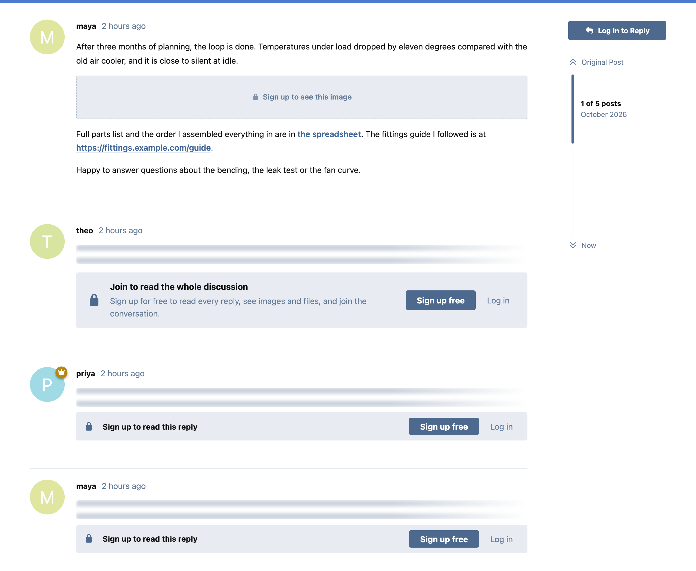
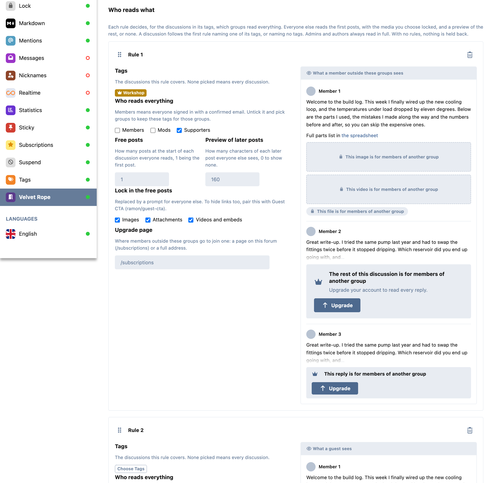

# Velvet Rope

Turn readers into members on Flarum 2. Guests get a set number of free
discussions, then a lead-in and a sign-up prompt. Replies, images,
attachments and embeds can be held back from guests, or kept for chosen
groups, per tag. Search engines can still index everything, marked the way
Google asks for paywalled content, so it isn't cloaking.



## Features

- **Free discussions for guests (metering).** Set an allowance per day, week
  or month. Discussions a guest has opened stay free until the period ends.
  After that a guest sees the start of the first post (you choose how many
  characters) and a prompt to sign up. A notice says how many free
  discussions are left once only a few remain. Tags can be left out of the
  count entirely.
- **Rules, per tag and per group.** Each rule covers some tags, or every
  discussion, and names the groups that read everything there. Everyone else
  reads the first posts (you choose how many), with the media you choose
  locked, and either a preview of each later post or none of it. Rules apply
  in the order you drag them into: a discussion follows the first rule
  naming one of its tags. One forum can let guests read the first post
  everywhere, and keep a "Workshop" tag for a supporters group, with an
  upgrade link for members outside it.
- **The right prompt for each reader.** Guests are asked to sign up (or log
  in, if sign-ups are closed). Accounts with an unconfirmed email can resend
  the confirmation email. Members outside a rule's groups get your upgrade
  page.
- **Locked media.** Images, attachments (FoF Upload) and videos or other
  embeds are replaced by a prompt. Links are never touched: to hide links
  from guests, pair this with [Guest CTA](https://github.com/ram0ng1/guest-cta).
- **Live preview.** Each rule in the admin page shows what someone outside
  it sees, drawn with the forum's own styles, as you change it. So does the
  meter.
- **Admins and authors** always read everything, including their own posts
  in a gated tag.



## Held back on the server, everywhere

What a reader may not see is removed before the post is rendered. It isn't
hidden with CSS, so it is not in the page source, the API, search results,
mention previews or the page served to browsers without JavaScript. The
same goes for notification email: a member following a discussion they
can't read in full is emailed the prompt, not the post. Replies pushed live
by Flarum Realtime are fetched again for each reader.

Other extensions that build their own text from a post's raw content (a
list excerpt, a feed, a federation document built in a queued job) don't go
through this. They can ask:

```php
$verdict = resolve(\ErnestDefoe\VelvetRope\Gate::class)->forPost($actor, $post);

if ($verdict->gated()) {
    // Show the reader less: $verdict->mode is 'lock', 'lead' or 'hide'.
}
```

## Search engines and SEO

Showing search engines content that visitors can't see is cloaking, unless
the page says it is paywalled. Velvet Rope follows Google's guidance for
[flexible sampling](https://developers.google.com/search/docs/appearance/flexible-sampling)
and [paywalled content](https://developers.google.com/search/docs/appearance/structured-data/paywalled-content):

- **Search engines read everything (on by default).** Googlebot, Bingbot,
  Applebot, Yandex and Baidu are proved by DNS: the address's reverse name
  must belong to the engine and resolve back to the same address. A user
  agent alone proves nothing. Lookups are cached for a day and capped per
  minute.
- **Gated parts are marked.** They are wrapped in `.VelvetRope-paywalled`,
  and the page carries `isAccessibleForFree: false` with a `hasPart` pointing
  at that class. With FoF SEO the properties go onto its own
  DiscussionForumPosting node; without it, Velvet Rope adds a small WebPage
  node.
- **The same page for everyone.** A guest with free discussions left gets
  exactly what a search engine gets, markup included. Only a guest past
  their allowance sees less.
- **Metering is cookie-based**, as Google recommends. A crawler, which keeps
  no cookies, is never counted.

Turn search engines off and they see what guests see: only the free posts get
indexed.

## Good to know

- The allowance is kept in a signed cookie. A guest who clears it starts
  again, as on any metered site. Turn on **Also count by network address**
  to catch them. People sharing one address (an office, a school, a mobile
  network) then share one allowance. Only a keyed hash of the address is
  kept, for the period.
- Out of the box, guests read the first post of each discussion and get a
  prompt in place of the replies. The meter is off until you turn it on.

## Installation

```sh
composer require ernestdefoe/velvet-rope
php flarum migrate
php flarum cache:clear
```

## Updating

```sh
composer update ernestdefoe/velvet-rope
php flarum migrate
php flarum cache:clear
```

## Support

[Issues](https://github.com/ernestdefoe/velvet-rope/issues) ·
[Support forum](https://ernestdefoe.online)

☕ If you like the things I have built, consider [buying me a coffee](https://buymeacoffee.com/ernestdefoe).

MIT licensed.
